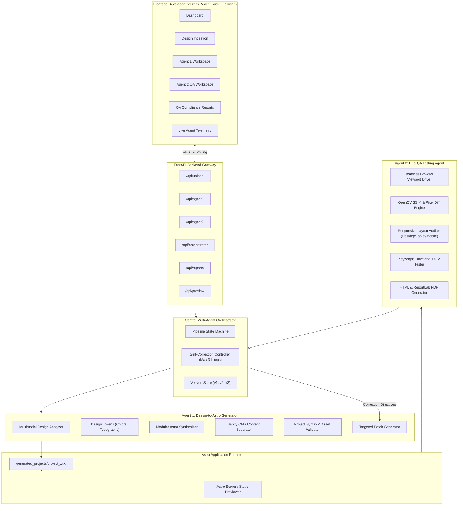

# System Architecture: Multi-Agent AI System for Frontend Development & QA Testing

## 1. Architectural Overview

The system automates the frontend development lifecycle from an initial website reference design to a fully validated, production-ready Astro application.

---

## 2. Agent 1: Design-to-Astro Code Generator

Agent 1 converts visual design mockups (PNG, JPG, PDF, Figma) into modular, production-ready Astro components.

### Core Modules:
1. **`analyzer.py`**:
   - Supports image inputs and multi-page PDFs (extracted to high-resolution PNGs via PyMuPDF).
   - Ingests Figma URLs and decomposes layouts into structural hierarchy.
   - Extracts semantic brand colors (e.g., `#0A192F` dark navy, `#C29B38` accent gold), font families, weights, and responsive line heights.
2. **`generator.py`**:
   - Generates modular Astro components:
     - `Header.astro` & `Navigation.astro`
     - `Hero.astro`
     - `About.astro`
     - `Sectors.astro`
     - `Stats.astro`
     - `Projects.astro`
     - `Contact.astro`
     - `Footer.astro`
     - `MainLayout.astro` & `index.astro`
   - Decouples structured content into `src/data/homepage.js`.
   - Generates responsive CSS in `src/styles/global.css`.
3. **`sanity_schemas.py`**:
   - Generates Sanity-ready schema definitions (`homepage.js`, `sector.js`, `featuredProject.js`, `siteSettings.js`) for CMS readiness.
4. **`refactorer.py`**:
   - Applies surgical patches during correction loops without regenerating unaffected code.

---

## 3. Agent 2: UI & QA Testing Agent

Agent 2 acts as a rigorous quality assurance automation engineer.

### Testing Tiers:
1. **Visual Testing (OpenCV & Pillow)**:
   - Computes Structural Similarity Index (SSIM) between original reference and rendered deployment.
   - Computes pixel delta percentage and mismatched pixel count.
   - Uses contour detection (`cv2.findContours`) to outline discrepancies with red bounding boxes.
   - Multimodal Vision LLM interprets layout differences.
2. **Responsive Testing**:
   - Audits 3 standard viewports:
     - Desktop: 1440 × 900
     - Tablet: 768 × 1024
     - Mobile: 375 × 812
   - Validates horizontal scroll overflow (`overflow-x`), text clipping, and navigation responsiveness.
3. **Functional DOM Testing**:
   - Navigation links: Verifies all links point to valid section IDs or URLs.
   - Interactive buttons: Validates labels and touch targets.
   - Corporate Contact Form: Checks for required inputs (name, corporate email, inquiry type) and submit triggers.
   - Image loading: Verifies `alt` attributes and asset paths.
4. **Report Engine**:
   - Generates interactive standalone HTML reports.
   - Compiles executive-grade PDF reports via ReportLab with tables, severity badges, and actionable recommendations.

---

## 4. Multi-Agent Orchestration & Closed Feedback Loop

The central Python orchestrator coordinates the agents through a 17-step state machine:
1. Accept reference design $\to$ Start Agent 1.
2. Receive design analysis $\to$ Generate Astro website (v1).
3. Validate generated code $\to$ Materialize to disk.
4. Start preview server $\to$ Capture Desktop, Tablet, and Mobile viewports.
5. Start Agent 2 $\to$ Run visual, responsive, and functional tests.
6. Assemble QA report.
7. If critical/high issues exist and iteration $< 3$:
   - Translate failed test cases into a typed `CorrectionDirective`.
   - Dispatch directive to Agent 1 refactorer.
   - Agent 1 patches affected components (producing v2 or v3).
   - Re-test website with Agent 2.
8. If all tests pass or iteration reaches limit $\to$ Mark run COMPLETED and produce final reports.
